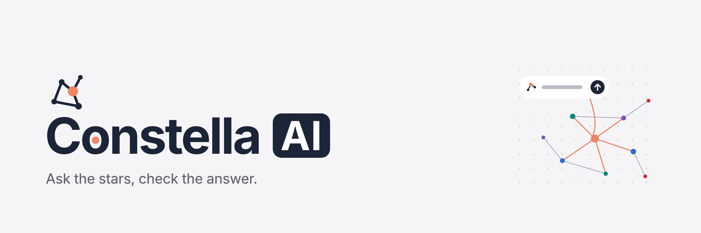

# Constella AI



Constella AI shows a store's sales as a network of product types: which ones are bought together,
which connect the others, and which form groups. You can ask questions about it in plain language,
in any language. Every figure in an answer comes from a lookup on the data, and you can open that
lookup to check it.

## For users

### The graph

Each dot is a **product type** (such as 鮮乳 or 吐司), not a single product. A line joins two
types that are often bought in the same basket. Click a type to see its best-selling products
and the types it goes with.

The toolbar sets what you see:

| Control | Options |
|---|---|
| **Period** | All time, or the last 30, 90, 180 or 365 days |
| **Segment** | All customers, or one customer segment (such as 忠誠客戶 or 新客戶) |
| **View** | **Default**; **Bridge**, which marks the types that connect the most others; **Community**, which colours the groups bought together |
| **Line width** | **Lift** (how much more often a pair is bought together than chance predicts), or the number of baskets that hold both |
| **Show product types with no pair** | Also shows types that are rarely bought with others, such as high-revenue items bought alone |

Two words come up often:

- **Lift** above 1 means a pair is bought together more often than chance predicts. Below 1
  means less often, however many baskets hold both.
- A **bridge** is a type that sits between many others. It isn't always the best seller.

### Asking questions

Type a question in the chat. The answer covers the period and segment the graph shows. Some
examples:

- *Which pair of product types has the highest lift?*
- *What do loyal customers buy with 吐司?*
- *Compare 忠誠客戶 and 新客戶 over the last 90 days.*
- *Which combinations could grow?*
- *Propose a campaign for breakfast products.*

Each answer can include:

- **Cited figures.** Each number carries a small tag, such as `L2`, that points to the lookup it
  came from.
- **Tool calls.** The list of lookups behind the answer. Open one to see what was asked and what
  came back.
- **A review verdict.** A ✓ means the answer was checked against the lookups. ↻ means the check
  found a problem and the answer was corrected. A warning means something could not be
  confirmed, with a note on what.
- **A chart**, when a picture shows more than the text.
- **Campaign options**, when you ask for something to do: two or three offers with product
  types, a discount, an audience and slogans. **Potential · to test** marks a combination the data
  suggests but that doesn't sell together much yet. Discounts aren't checked against margin,
  because there is no cost data.
- **Show on the graph**, which highlights the types and pairs the answer is about.

To keep a product type out of every campaign, click it on the graph and choose **Leave out of
campaigns**. It stays on the graph, and questions about it are still answered.

The assistant only answers questions about the store's sales. It tells you when something
isn't in the data instead of guessing.

## For developers

### How it works

```
frontend (React + Vite)  ──/api──▶  backend (FastAPI)  ──▶  Postgres: invoice table
                                        │
                                        └──▶  OpenAI Agents SDK
```

- **`GET /api/network?days=&segment=`** builds the graph for a scope: product types, pairs above
  a minimum basket count, lift, communities and bridges.
- **`POST /api/ask`** answers a question. **`POST /api/ask/stream`** gives the same answer as
  lines of JSON: one `{"step": ...}` line as each step starts, then one `{"answer": ...}` or
  `{"error": ...}`.

`AGENT_VERSION` picks how a question is answered:

| Version | What it does |
|---|---|
| `1` | Prompt only: the network is summarised in the prompt. A baseline for the evals. |
| `2` | One agent with tools. Its answer is reviewed, and a chart is added. |
| `3` (default) | Roles, each checked by code before the next one runs: |

```
router ─▶ analyst (reviewed) ─▶ strategist (reviewed, if asked) ─▶ writer
       └▶ scientist (if a chart helps)
```

- **Router** (`roles/router.py`): plans the run. It turns down questions outside the store's
  sales.
- **Analyst** (`roles/analyst.py`): answers from the tools. Every figure cites a ledger entry.
- **Reviewer** (`roles/reviewer.py`): code, no model. It checks that each figure is in the result
  it cites, that each number in the text came from the question or a tool, and that each item
  and pair is on the graph. A failed check sends the answer back once to be fixed.
- **Strategist** (`roles/strategist.py`): drafts two or three campaigns. Code checks that each one
  can run as written: its types are on the graph, the discount is in range, and the audience is a
  real segment.
- **Writer** (`roles/writer.py`): writes slogans for campaigns that passed.
- **Scientist** (`roles/scientist.py`): picks a chart and points it at one tool result. It never
  types a number, so a chart can't show a figure the tools didn't return.

The tools are in `app/tools/`. Each call is written to the run's **ledger** (`L1`, `L2`, …),
and that ledger is what the reviewer and the app's citations read.

### Project layout

```
backend/
  app/
    main.py        API routes and version selection
    infra/         Database access, SQL queries (infra/sql/), progress events
    tools/         The agents' tools: lookups, potential pairs, name matching
    roles/         v3's roles: router, analyst, reviewer, strategist, writer, scientist
    versions/      v1, v2, v3
  tests/           Unit tests (no database or API key needed)
  evals/           Evaluations against a golden set and labelled cases
frontend/
  src/
    graph/         The network graph, toolbar and item card
    chat/          Chat, answer card, charts, progress
```

### Requirements

- Python 3.13+ and [uv](https://docs.astral.sh/uv/)
- Node.js and npm
- PostgreSQL with an `invoice` table (columns below)
- An OpenAI API key
- [prek](https://prek.j178.dev), for the git hooks

The API reads one table, `invoice`, with one row per invoice line:

| Column | Meaning |
|---|---|
| `inv_num` | Invoice number: one basket |
| `datetime` | When it was bought |
| `user_id`, `segment` | The customer and their segment (such as an RFM segment) |
| `county`, `city` | Where |
| `item_tag` | The product type: a dot on the graph |
| `item_name`, `item_brand_name` | The product |
| `price`, `unit`, `amount` | Price, quantity and line total |

`backend/evals/data/invoice.sql` creates this table.

### Setup

```bash
make install
```

This installs the backend and frontend dependencies and the git hooks. It also creates
`backend/.env` from `backend/.env.example` if it's missing. Then fill in `backend/.env`:

| Variable | |
|---|---|
| `DATABASE_URL` | Postgres with the `invoice` table. The API only reads from it. |
| `OPENAI_API_KEY` | Required |
| `TEST_DATABASE_URL` | An empty database for the evals. **Never the real one:** the evals drop and refill its `invoice` table. |
| `OPENAI_MODEL` | Optional. Unset uses the Agents SDK's default model. |
| `AGENT_VERSION` | Optional. `1` or `2`. Unset means v3. |
| `ROUTER_MODEL` | Optional. A smaller model for the router. |
| `WRITER_MODEL` | Optional. The model for slogans. |
| `CHARTS` | Optional. `0` turns off charts, which saves one model call. |

### Running

In two terminals:

```bash
make backend    # API on http://localhost:8000
make frontend   # app on http://localhost:5173 (proxies /api to the backend)
```

### Tests and checks

```bash
make test       # backend unit tests: no database or API key needed
make lint       # every prek hook: ruff, sqlfluff, whitespace
make build      # type-check and build the frontend
```

The hooks also run on every commit.

### Evals

The evals score the agent against known answers. They need `TEST_DATABASE_URL` and
`OPENAI_API_KEY`, and they call the model, which costs money.

```bash
make golden          # generate the sample data and rebuild the golden set (refills the test database)
make eval            # the whole system on the golden set
make eval-analyst    # the analyst alone
make eval-router     # routing decisions
make eval-scientist  # chart choices
make eval-writer     # slogans, and the judge of their puns
```

The sample data (`evals/data/invoice.csv`) isn't committed. `make golden` generates it with a
fixed seed, so every run produces the same file.

Run `make help` to list every command.
