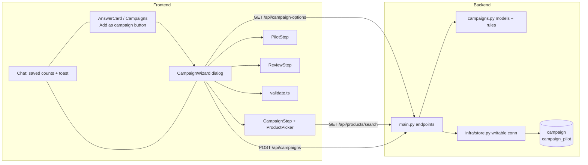

# Campaign from strategy — Technical Plan

Requirements: ./requirements.md
Last updated: 2026-11-07

> **Changed 2026-11-07 (CAI-7):** proposals are not stored and conversion is not measured (D4).
> There is no `campaign_proposal` table, no `proposal_id` on answers or campaigns, and `/api/ask*`
> is unchanged. A campaign keeps a copy of the AI proposal it came from in
> `campaign.source_proposal` (JSONB). Product search scores with `search.score` (D6).

## Summary

Each proposed campaign in a v3 strategy answer gets an "Add as campaign" button. Proposals are
not stored and the chat endpoints are unchanged: the frontend already holds the proposal. The button opens a three-step wizard built on the native `<dialog>` element.
The wizard is prefilled from the proposal and checks each step in the browser for quick feedback.
On Save it posts the draft to a new `POST /api/campaigns`. That endpoint checks the draft again in
code (the authoritative check) and writes one `campaign` row, plus one `campaign_pilot` row when
there is a pilot, in a single transaction over a writable connection. A campaign saved from a
proposal keeps a copy of it, as shown, in `source_proposal`. The invoice reads stay
read-only. Product search reuses the fuzzy matcher the agent already uses (`app/tools/search.py`)
over the cached catalog. The new tables live in the same Postgres database (`DATABASE_URL`). An
idempotent SQL script creates them, run by a new `make migrate`.

## Codebase context

- **API**: [backend/app/main.py](../../../backend/app/main.py). FastAPI, Pydantic bodies, and
  `Field` constraints give 422s. `/api/ask` and `/api/ask/stream` both call
  `chosen().ask(...)`.
- **Data access**: [backend/app/infra/data.py](../../../backend/app/infra/data.py). Named SQL files in
  `app/infra/sql/` run through `query(name, params)` on a connection opened with
  `default_transaction_read_only=on`. `load_catalog()` is cached and maps each product type to its
  product names, over all the data. Segments come from `sql/segments.sql`.
- **Proposal shape**: `strategist.Campaign` (name, basis, items, discount_percent, audience,
  reason). `writer.Pitch` adds slogans, and `writer.Pitched` is what `v3.Answer.strategy` holds
  ([strategist.py:74](../../../backend/app/roles/strategist.py#L74),
  [writer.py:109](../../../backend/app/roles/writer.py#L109)).
- **Fuzzy matching**: `search.score(typed, name)`, which `search.best` also calls. It scores
  containment, the longest shared run and shared characters, and it already handles typos
  ("teapto" → "teapot") and CJK names.
- **Location data**: `invoice.county` and `invoice.city`. There is no country column. The location
  is **county**, per decision D1 (requirements.md is updated to match).
- **Frontend**: React 19 and Tailwind 4, with no UI, form or test libraries. Types are mirrored by
  hand in `src/types.ts`, and fetches live in `src/api.ts`. Proposal cards render in `Campaigns`
  inside [AnswerCard.tsx](../../../frontend/src/chat/AnswerCard.tsx). The only frontend check is
  `make build` (tsc).
- **Tests**: pytest in `backend/tests/`, with no database and no model. They monkeypatch `data.*`
  and the agent (see `tests/test_main.py`). The new code follows the same pattern: rules are pure
  functions, and the storage functions are monkeypatched in API tests.
- **Conventions followed without asking**: named SQL files linted by sqlfluff, docstrings that
  explain *why*, `{"error": ...}`-free REST (plain HTTP status codes for the new endpoints, since
  these are not agent tools), and tsc as the frontend gate.

## Components



### C1. Schema and migration
- Responsibility: creates the two tables idempotently, and gives a `make migrate` target to run
  that.
- Location (new):
  - `backend/app/infra/sql/schema/campaigns.sql`
  - `backend/app/infra/migrate.py`, which runs every file in `sql/schema/` in name order on a
    writable connection
- Location (modified): `Makefile` gets `migrate`, `backend/.env.example` gets a comment, and
  `README.md`/`CLAUDE.md` mention that the API now also writes these tables.
- Requirements covered: FR10

### C2. Store (writable data access)
- Responsibility: the only module that writes. It holds `save_campaign` (one transaction), and
  also `load_counties` (read-only, cached) for the county options.
- Location (new):
  - `backend/app/infra/store.py`
  - `backend/app/infra/sql/save_campaign.sql`, `save_pilot.sql` and
    `campaign_by_token.sql`
  - `backend/app/infra/sql/counties.sql` (read)
- Requirements covered: FR10, and FR3 (the county options)

### C3. Campaign models and rules
- Responsibility: the Pydantic request and response models, and `draft_problems(...)`, a pure
  function that returns every rule a draft breaks, as `(field path, message)` pairs.
- Location (new): `backend/app/campaigns.py`
- Requirements covered: FR3, FR6, FR7 (authoritative server side), FR10

### C4. API endpoints
- Responsibility:
  - `GET /api/campaign-options`
  - `GET /api/products/search` (`backend/app/products.py`)
  - `POST /api/campaigns`
- Location (modified): `backend/app/main.py`. `/api/ask`, `/api/ask/stream` and `writer.py` are
  unchanged.
- Requirements covered: FR5 (search), FR10

### C5. Frontend types and API client
- Responsibility: mirror the new shapes, and add `getCampaignOptions()` (cached promise like
  `getNetwork`), `searchProducts(q, signal)` and `saveCampaign(body)`. `saveCampaign` throws a
  `CampaignError` that carries the 422's field errors.
- Location (modified): `frontend/src/types.ts`, `frontend/src/api.ts`
- Requirements covered: FR5, FR10

### C6. Wizard shell
- Responsibility:
  - The `<dialog>` opened with `showModal()`, which is centered with a backdrop by default.
  - The step indicator (Campaign · Pilot · Review), Next/Back, and the draft state, which is held
    above the steps so Back keeps every value.
  - A discard confirmation on Esc, X or a click on the backdrop when the draft is dirty.
  - The duplicate warning before Save, and Save itself, disabled while pending.
  - Server field errors mapped back to their step and field.
- Location (new): `frontend/src/campaign/CampaignWizard.tsx`,
  `frontend/src/campaign/draft.ts` (`fromProposal`, `toRequest`, `isDirty`)
- Requirements covered: FR2, FR4, FR8, FR11, FR12, FR13

### C7. Step 1: campaign form and product picker
- Responsibility:
  - The fields: title, strategy, products, discount, start/end dates, segment (select with an
    "All customers" option) and counties (multi-select checkbox list, none = all counties).
  - `ProductPicker`: a search box debounced by 200 ms that calls `searchProducts`, plus a results
    list in which each result is labelled "Type" or "Product". The selected products are shown as
    removable chips.
- Location (new): `frontend/src/campaign/CampaignStep.tsx`,
  `frontend/src/campaign/ProductPicker.tsx`
- Requirements covered: FR3, FR5

### C8. Step 2: pilot form
- Responsibility: the "Run a pilot first" switch, and the size %, dates, discount and auto-start
  toggle, which are shown only when the switch is on. Turning the switch off keeps the typed values
  in state but sends `pilot: null`.
- Location (new): `frontend/src/campaign/PilotStep.tsx`
- Requirements covered: FR6

### C9. Step 3: review
- Responsibility: a read-only summary of every field, worded for people ("All customers", "All
  counties", "No pilot", "When the pilot passes: start automatically" / "hold for my approval"),
  plus Back and Save.
- Location (new): `frontend/src/campaign/ReviewStep.tsx`
- Requirements covered: FR9

### C10. Client-side rules
- Responsibility: `stepErrors(step, draft, today)` returns the problems of one step, keyed by
  field. These are the same rules as C3, so Next can be blocked. It is a pure function with no
  React.
- Location (new): `frontend/src/campaign/validate.ts`
- Requirements covered: FR7, FR8

### C11. Chat integration
- Responsibility:
  - "Add as campaign" on each proposal card. It reads "Saved ✓" once that proposal has been
    saved. A proposal is keyed by its position in its answer (answer index and campaign index).
  - `Chat` holds `saved: Record<proposalKey, number>` for the session and the wizard's open state.
  - The wizard sends the clicked proposal as `source_proposal`.
  - A "Campaign saved" toast (`role="status"`, auto-hides after 4 s).
- Location (modified): `frontend/src/chat/AnswerCard.tsx`, `frontend/src/chat/Chat.tsx`
- Location (new): `frontend/src/campaign/Toast.tsx`
- Requirements covered: FR1, FR11, FR13

### FR traceability

| FR | Components |
|---|---|
| FR1 | C11 |
| FR2 | C6 |
| FR3 | C3, C7, C2 (counties) |
| FR4 | C6 (`draft.fromProposal`) |
| FR5 | C4, C5, C7 |
| FR6 | C3, C8 |
| FR7 | C3, C10 |
| FR8 | C6, C10 |
| FR9 | C9 |
| FR10 | C1, C2, C3, C4, C5 |
| FR11 | C6, C11 |
| FR12 | C6 |
| FR13 | C6, C11 |

## Data model

`backend/app/infra/sql/schema/campaigns.sql` is idempotent and safe to re-run:

```sql
CREATE TABLE IF NOT EXISTS campaign (
  id UUID PRIMARY KEY,                       -- made in Python (uuid4): no extension needed
  source_proposal JSONB,                     -- the AI proposal it came from, as shown; NULL = not from one
  client_token UUID NOT NULL UNIQUE,         -- one per wizard opening: a double-click saves once
  status TEXT NOT NULL DEFAULT 'scheduled' CHECK (status IN ('scheduled')),
  title TEXT NOT NULL CHECK (title <> ''),
  strategy TEXT NOT NULL CHECK (strategy <> ''),
  item_types TEXT[] NOT NULL DEFAULT '{}',   -- invoice.item_tag values
  products TEXT[] NOT NULL DEFAULT '{}',     -- invoice.item_name values (SKUs)
  discount_percent INTEGER NOT NULL CHECK (discount_percent BETWEEN 1 AND 100),
  starts_on DATE NOT NULL,
  ends_on DATE NOT NULL,
  segment TEXT,                              -- NULL = all customers
  counties TEXT[] NOT NULL DEFAULT '{}',     -- empty = all counties
  created_at TIMESTAMPTZ NOT NULL DEFAULT NOW(),
  CHECK (ends_on >= starts_on),
  CHECK (CARDINALITY(item_types) + CARDINALITY(products) > 0)
);

CREATE TABLE IF NOT EXISTS campaign_pilot (
  campaign_id UUID PRIMARY KEY REFERENCES campaign (id) ON DELETE CASCADE,
  audience_percent INTEGER NOT NULL CHECK (audience_percent BETWEEN 1 AND 99),
  starts_on DATE NOT NULL,
  ends_on DATE NOT NULL,
  discount_percent INTEGER NOT NULL CHECK (discount_percent BETWEEN 1 AND 100),
  auto_start BOOLEAN NOT NULL,               -- true: start the campaign when the pilot passes
  CHECK (ends_on >= starts_on)
);
```

- A campaign has no pilot when it has no `campaign_pilot` row.
- The rule "pilot ends before the campaign starts" spans two tables, so it is enforced in code
  (C3) and not by a CHECK constraint.
- Arrays (not join tables) keep each campaign readable in one `SELECT`, which is what the user will
  do to verify it.
- `source_proposal` holds the strategist `Campaign`'s six fields (`name`, `basis`, `items`,
  `discount_percent`, `audience`, `reason`). It records what the AI proposed, not what will run, so
  it is not checked against the catalog. Compare it with the saved fields in SQL, e.g.
  `SELECT title, source_proposal->>'name', discount_percent, source_proposal->'discount_percent'
  FROM campaign WHERE source_proposal IS NOT NULL;`

## Interfaces & contracts

### Shared JSON shapes (snake_case on the wire, like `discount_percent` today)

```ts
// frontend/src/types.ts: Campaign (the strategist's proposal) is unchanged.

type ProductKind = "type" | "product"
interface ProductRef { kind: ProductKind; name: string }          // what a draft holds
interface ProductHit extends ProductRef { type: string }          // search result; `type` = its item_tag (= name for kind "type")

interface CampaignOptions { segments: string[]; counties: string[] }

interface PilotDraft {
  audience_percent: number      // int 1–99
  starts_on: string             // "YYYY-MM-DD"
  ends_on: string
  discount_percent: number      // int 1–100
  auto_start: boolean
}

interface CampaignDraft {
  source_proposal: Campaign | null  // the proposal it came from, as shown; extra keys (slogans) are ignored
  client_token: string          // uuid, crypto.randomUUID() when the wizard opens
  title: string                 // trimmed, non-empty, ≤ 200 chars
  strategy: string              // trimmed, non-empty, ≤ 4000 chars
  products: ProductRef[]        // ≥ 1, no duplicates
  discount_percent: number      // int 1–100
  starts_on: string
  ends_on: string
  segment: string | null        // null = all customers
  counties: string[]            // [] = all counties, no duplicates
  pilot: PilotDraft | null      // null = no pilot
}

interface SavedCampaign extends Omit<CampaignDraft, "client_token"> {
  id: string
  status: "scheduled"
  created_at: string            // ISO timestamp
}
```

Backend Pydantic models in `app/campaigns.py` mirror these field for field: `ProductRef`, `Pilot`,
`CampaignDraft` and `SavedCampaign`. The JSON body uses `products: ProductRef[]`, and the store
splits it into `item_types` and `products` arrays by `kind`. `SavedCampaign` rebuilds the list.

### Endpoints

**`GET /api/campaign-options`** → `200 CampaignOptions`
- `segments` comes from the existing `segments.sql` (all data). `counties` comes from
  `SELECT DISTINCT county ... ORDER BY county`. Both are cached for the server's life, like the
  catalog.

**`GET /api/products/search?q=<text>&limit=<1..50, default 20>`** → `200 ProductHit[]`
- Types (`load_catalog()` keys) and products (its values) are scored with `search.score`, kept at
  `search.GOOD_ENOUGH` or above, and sorted by score, then types before products, then name. The
  best `limit` come back.
- If `q` is blank after trimming → `[]`. If `limit` is out of range → 422.

**`POST /api/campaigns`**, body `CampaignDraft`:
- `201 SavedCampaign`: created.
- `200 SavedCampaign`: a campaign with this `client_token` already exists, so it is returned
  unchanged (a double submit).
- `422`: shape errors (FastAPI default) **or** rule errors, both in FastAPI's shape
  `{"detail": [{"loc": ["body", <field>, ...], "msg": str, "type": str}]}`. Rule errors use
  `type: "campaign_rule"` and these `loc`/`msg` pairs:

  | Rule | loc | msg |
  |---|---|---|
  | blank title / strategy | `["body","title"]` / `["body","strategy"]` | `Required.` |
  | no products | `["body","products"]` | `Add at least one product.` |
  | unknown product | `["body","products",i]` | `<name> is not in the catalog.` |
  | duplicate product/county | `["body","products"|"counties",i]` | `Listed twice.` |
  | unknown segment | `["body","segment"]` | `<name> is not a segment.` |
  | unknown county | `["body","counties",i]` | `<name> is not a county.` |
  | start in the past | `["body","starts_on"]`, `["body","pilot","starts_on"]` | `Must be today or later.` |
  | end before start | `["body","ends_on"]`, `["body","pilot","ends_on"]` | `Must be on or after the start date.` |
  | pilot not before campaign | `["body","pilot","ends_on"]` | `Pilot must end before the campaign starts.` |
- `500`: the database is unreachable or the write failed, with nothing stored. The client shows
  "Could not save the campaign. Try again." and keeps the dialog open.
- "Today" is the server's local date (`date.today()`).
- Discount and percent ranges, and the integer types, are enforced by Pydantic `Field(ge=, le=)`
  with `strict` ints. So 12.5 → 422.

**`/api/ask` and `/api/ask/stream`**: unchanged.

### Python signatures

```python
# app/infra/store.py
def save_campaign(draft: CampaignDraft) -> tuple[SavedCampaign, bool]: ...
    # (row, created); False when client_token existed
@lru_cache
def load_counties() -> list[str]: ...

# app/campaigns.py
def draft_problems(
    draft: CampaignDraft, catalog: dict[str, list[str]], segments: Sequence[str],
    counties: Sequence[str], today: date,
) -> list[tuple[tuple[str | int, ...], str]]: ...   # (loc without "body", msg); pure
```

### Frontend component props

```ts
// CampaignWizard.tsx
{ proposal: Campaign; alreadySaved: number; onClose: () => void; onSaved: (c: SavedCampaign) => void }
// Steps share: { draft: WizardDraft; errors: FieldErrors; onChange: (patch: Partial<WizardDraft>) => void }
// WizardDraft = CampaignDraft with `pilotOn: boolean` + `pilot: PilotDraft` (always held; sent only if pilotOn)
// FieldErrors = Record<string, string>   // key = loc joined by ".", e.g. "pilot.ends_on", "products.2"
// validate.ts
stepErrors(step: 1 | 2 | 3, draft: WizardDraft, today: string): FieldErrors
// step 3 = steps 1 and 2 together
```

## Decisions

- **D1: Location is the county** (`invoice.county`), as a multi-select. Empty means all.
  - Chosen by the user: the data has no country column.
  - Alternatives: county + city, city only.
- **D2: Storage is new tables in the same Postgres (`DATABASE_URL`)**, written through a separate
  connection in `store.py`. `data.py` stays read-only.
  - Chosen by the user: the user can inspect it next to the data.
  - Alternatives: a separate DB, SQLite.
- **D3: The schema comes from an idempotent SQL script plus `make migrate`.**
  - Chosen by the user: it is explicit, reviewable and linted by sqlfluff.
  - Alternative: create the tables on startup.
- **D4: Proposals are not stored. A campaign keeps a copy of its proposal in `source_proposal`.**
  - Chosen by the user (2026-11-07), replacing "store proposals when shown, with a
    `Pitch.proposal_id`". Conversion is not measured (FR14 dropped), and the chat path is untouched.
  - The copy is whatever the frontend sends; for one shared app with no login, used to trace a
    campaign back to what the AI said, that is acceptable.
- **D5: Validation runs on both sides with the same rules.** The server's check (C3) is
  authoritative and returns field-addressed 422s. The client's check (C10) blocks Next for fast
  feedback.
  - Alternative: server-only validation on Save, which would fail AC4, AC5, AC7 and AC8, since those
    need Next to be blocked.
- **D6: Fuzzy search runs on the server and reuses `search.score`** over the cached catalog.
  - Chosen because it is the matcher the agent already trusts, and the full SKU list never ships to
    the browser.
  - `search.best` calls the same `score` and `GOOD_ENOUGH`, but takes bare names and returns bare
    names, so it would lose each hit's kind and type, and it breaks ties by name instead of types
    first. `search_products` scores each candidate itself, so it ranks the same hits.
  - Alternative: a client-side library such as Fuse.js, which means a new dependency and sending the
    whole catalog.
- **D7: The modal is the native `<dialog>` with `showModal()`.**
  - Chosen because it gives centering, a backdrop, focus trapping and Esc with no new dependency,
    which matches the repo's no-UI-library style.
- **D8: Idempotent save uses `client_token`**, a UUID per wizard opening with a UNIQUE constraint,
  and Save is disabled while pending.
  - Re-saving on purpose (Flow 5) opens a new wizard, which gets a new token and therefore a new row.
- **D9: The "saved" markers live in `Chat` state for the session** (requirements accept a reset on
  reload). No endpoint lists campaigns.
- **D10: No frontend test framework is added.**
  - Rules are covered by backend pytest (C3), which has the same rules as `validate.ts`.
  - The frontend gate stays `make build`, and the wizard is checked by hand against the ACs.
  - Alternative: add Vitest for `validate.ts` and `draft.ts`. This is cheap if you want it; say so
    and it becomes its own issue.

## Risks, rollout & open questions

- **Writes to the data database.** The API's DB user now needs INSERT and SELECT on the two
  tables, and `make migrate` needs CREATE. Document this in `.env.example`. Never point the evals'
  `TEST_DATABASE_URL` flow at these tables: `make golden` only drops `invoice`, so that is safe.
- **Search performance.** `search.score` scores every SKU with `SequenceMatcher` on each request. If
  the catalog is large (more than ~20k names) that may take over 100 ms. Mitigation: a 200 ms
  debounce, an abort of stale requests (`AbortController`), and `limit` ≤ 50. Measure on the real
  catalog in the search issue, and add a pre-filter only if needed. (CAI-7 added one: names that
  share no character with the query are skipped, since they score 0.)
- **The "today" boundary.** The client computes today in the browser's timezone, and the server
  uses the server's. Near midnight they can disagree. The server wins, and its 422 is shown on the
  date field.
- **Proposals that failed review** still get a button, because they were shown (FR1). Their
  product types may be off the current graph, but they are always in the catalog.
- **Proposed type missing from the catalog** (edge case): the catalog covers all data and does not
  change while the server runs, so this is practically unreachable. If it happens, the 422 on Save
  marks the product. **Deviation:** the requirements ask for the flag before Next. Accepted, because
  it cannot happen with the current data. Revisit if the catalog becomes live.
- **Rollout:** run `make migrate` before deploying the backend. There is no feature flag: without
  the tables, `POST /api/campaigns` returns 500, and nothing else breaks.
- **Backwards compatibility:** no response shape changes, so v1/v2/v3 answers and the evals are
  unaffected.
- **Open questions:** none blocking.
